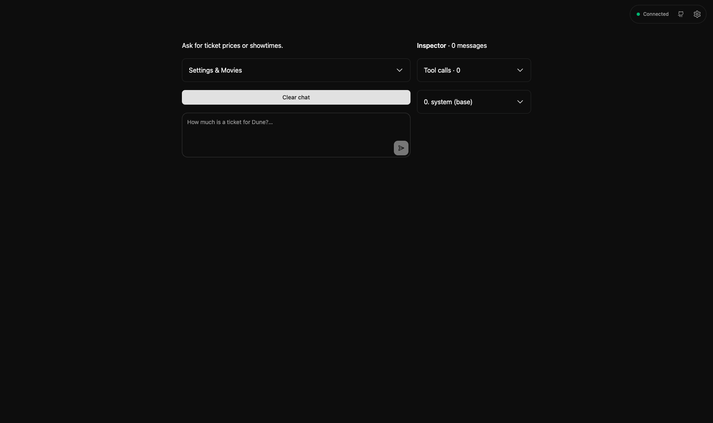
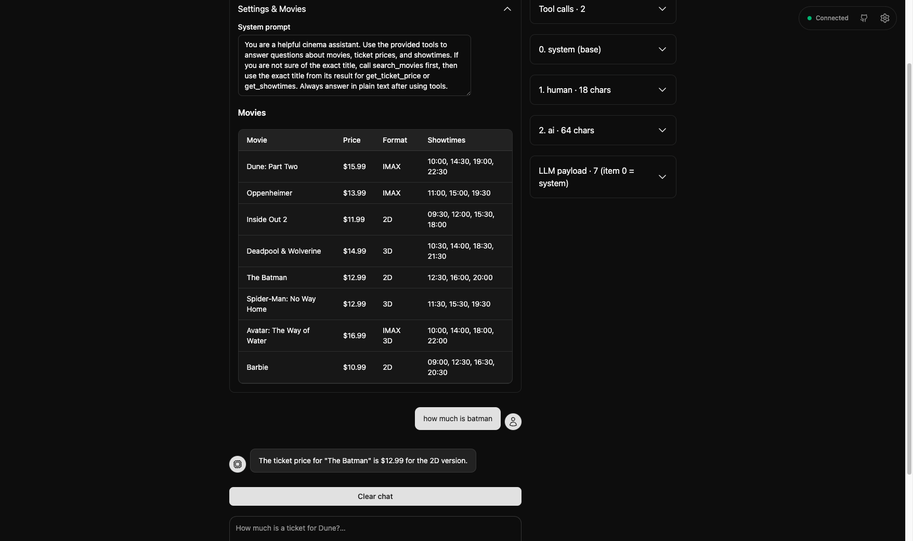

# Movie Ticket Assistant

Backroad + OpenAI chat assistant with tool calls. Ask for ticket prices or showtimes.

## Setup

Requires Node 24.

```bash
nvm use
npm install
cp .env.example .env
```

Set `OPENAI_API_KEY` in `.env` (`OPENAI_MODEL` defaults to `gpt-4o-mini`). Without a key, the app runs in demo mode with canned text.

## Run

```bash
npm run dev        # serves on :3335
npm run typecheck
```

## How it works

- `src/movies.ts` — movie data
- `src/tools.ts` — `search_movies`, `get_ticket_price`, `get_showtimes` + OpenAI tool schemas; `handle_tool_calls()` runs them
- `src/ai.ts` — `buildMessages()` shapes `[system, ...history, user]`; `chat()` loops `finish_reason === 'tool_calls'` until a text answer
- `src/app.ts` — Backroad UI, two-pane layout (chat left, Inspector right); `history` = clean chat bubbles, `payload` = full LLM trace
- `src/inspector.ts` — right pane showing tool calls, history, and LLM payload

## Screenshots




